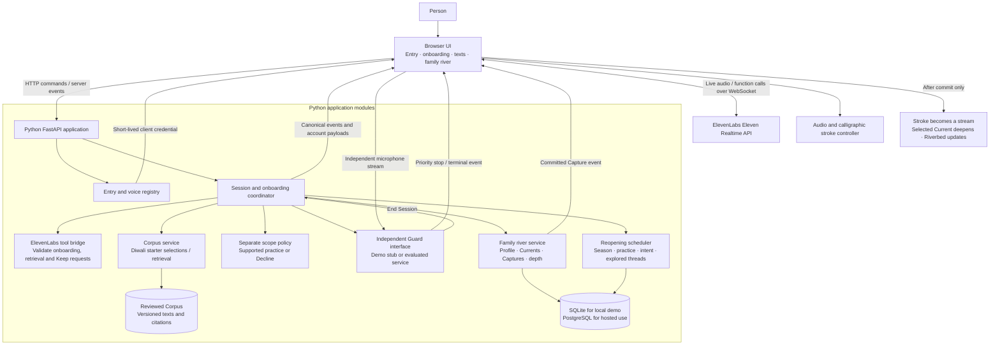
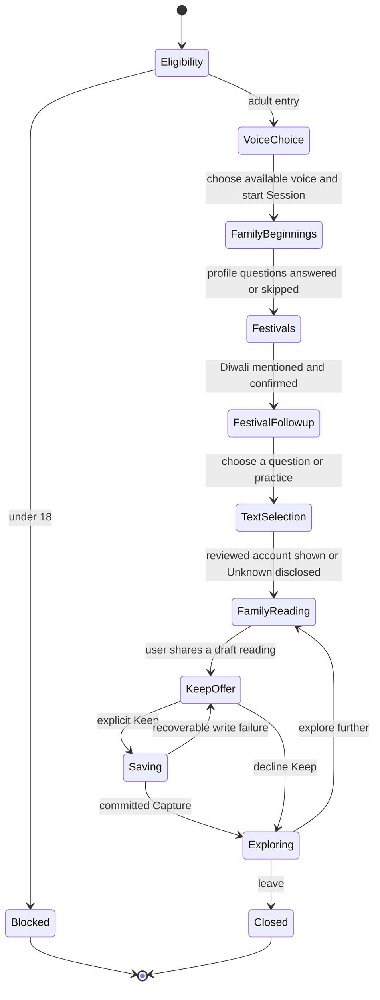
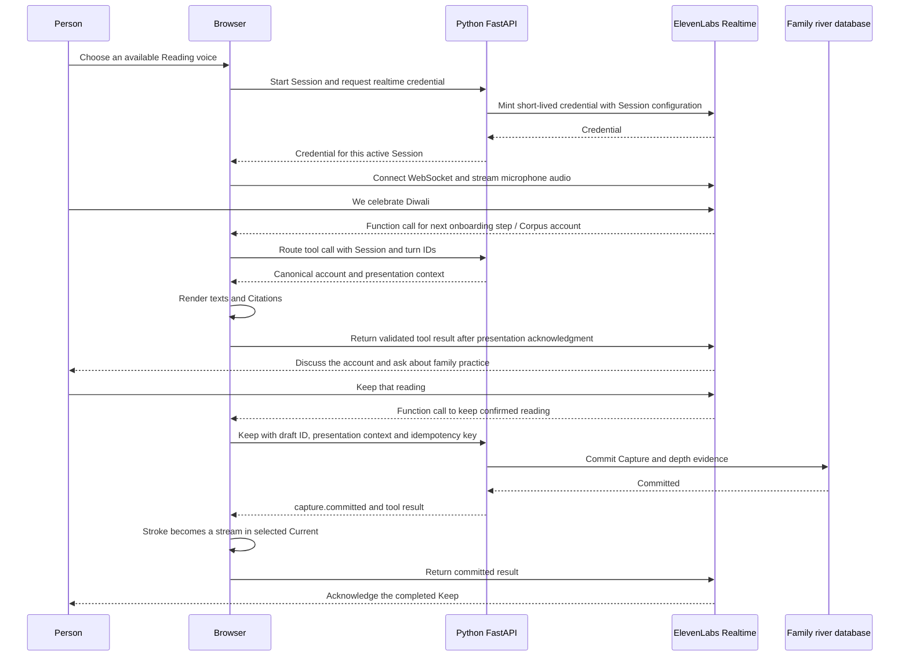

# Sngm proof-of-concept webapp architecture

Status: target architecture; a first local implementation was added 17 November 2026. See README for implemented behavior and remaining gaps. Python backend, conversational onboarding and ElevenLabs Realtime live voice are required by the latest user direction.

## Recommendation

Build a browser frontend backed by a **Python FastAPI application from the first version**. The demo has two entry journeys: fresh onboarding into Diwali, and a returning Avni identity with a seeded Ahoi Ashtami river. The [two-scenario demo plan](demo-scenarios.md) specifies fixtures, steps and acceptance. In the first journey, the guide welcomes the person, offers the available Reading voices, asks a few questions about their family and festivals, follows their mention of Diwali, presents selected reviewed texts, then helps them keep a Family reading or Own reading on their new Family river.

Use TypeScript/Vite for browser interaction and the existing Sngm design system. Python owns onboarding progression, content selection/retrieval, persistence, Current depth policy and Reopening scheduling. Start with SQLite and versioned reviewed content for a local demo. Evolve to PostgreSQL with pgvector and Python embedding/retrieval workers when live retrieval is introduced. The backend is not deferred until the live AI milestone.

Use **ElevenLabs Eleven Realtime API** for the live guide. The Python backend can run locally, but live speech requires internet access to ElevenLabs. Keep bundled texts, fonts and a separately labelled deterministic rehearsal mode usable without external networking; never silently substitute scripted speech when the live connection fails.

This document is the build plan. The first Python webapp and onboarding slice now exist. The independent live Guard, reviewed passages, SSE transport and some target contracts below remain unimplemented.

## Decisions and sources

| Source | How it applies |
|---|---|
| Latest user direction | Python backend is mandatory; onboarding and a Diwali first exploration are in scope. Voice selection precedes family questions; ElevenLabs Realtime is the live provider. |
| [Domain glossary](../../../CONTEXT.md) | Keep Corpus, Family river, Current, Capture, Unknown, Decline and Route-out distinct. |
| [Existing product architecture](../../../06-architecture/system-architecture.md) | Preserve reviewed content, private rivers, independent Guard and fixed Route-out. |
| [Product brief](../../../04-concept/product-design-brief.md) | Learn from sources beside family practice; voice is primary; the screen is the record. |
| [Earlier runbook](../../../07-demo/README.md) and [plan](../../../plan.md) | Useful rehearsal and disclosure requirements. Their single seeded Ahoi demo is expanded into two journeys: fresh Diwali onboarding and a returning Avni/Ahoi scenario. |
| [Design system](../../sngm-design-system/DESIGN.md) and [component contracts](../../sngm-design-system/COMPONENTS.md) | Reuse both light readings, the calligraphic voice, selectable Currents and Riverbed. |

This revision replaces the earlier browser-only/localStorage recommendation and the later TypeScript-backend suggestion. It also replaces Neutral-only onboarding with selection of an available Reading voice before the learning Session. The [two-scenario demo plan](demo-scenarios.md) restores Avni’s seeded river as a second entry point using the same backend and live provider. The older parent documents have not been rewritten; use this revision for implementation scope and the glossary for unchanged domain definitions.

## System diagram



These are modules in one Python application, not separate microservices. The Corpus is logically separate from private user data even if the first deployment uses one database server. No user-facing endpoint can publish a private Capture into the Corpus.

## The first experience

This section describes the fresh Diwali scenario. Avni’s returning-user scenario skips completed onboarding and loads its isolated seeded river. The onboarding is a conversation, not a long form. The family river starts empty. Its first meaningful practice emerges from what the person says, rather than from a seeded interviewee’s profile.

| Step | What the person experiences | Backend responsibility |
|---|---|---|
| Entry | A minimal adult eligibility check before meeting the guide. | Reject under-18 entry before creating a Session or river. For a local demo, establish an isolated adult demo identity without building email/password flows. |
| Welcome and voice | The guide appears as the calligraphic line: “Which of these available voices would you like me to use?” | Return enabled, authorized voices. A short Neutral setup welcome is outside the learning Session. Lock the selection when the Session starts. |
| Family beginnings | “What should I call you?” Then where they live and where their family comes from. | Save only supplied profile fields and onboarding progress. Permit skipping or correcting them; do not infer identity or belief. |
| Festivals | “Which festivals do you celebrate at home?” | Keep the person’s wording; map a supported mention such as “Diwali” to a canonical festival. Confirm ambiguous matches. |
| Follow Diwali | “You mentioned Diwali. What would you like to understand about it?” | Set the active festival and invite a first Current, such as lighting the home, rather than treating all Diwali practices as one interchangeable ritual. |
| Selected texts | Show a small prepared selection of reviewed passages about the aspect they chose, with named provenance and any distinct Interpretations unranked. | Return a canonical versioned Corpus account. The frontend renders it before speech; unavailable claims remain Unknown. |
| Family practice | “What does Diwali look like in your family?” Follow concrete details, such as lighting diyas, cooking, or repairing a light. | Hold a draft Family reading attached to the relevant Current and the accounts actually shown. Keep their words separate from Corpus claims. |
| First Keep | “Would you like to keep that on your river?” The person confirms or edits it. | Commit the Capture, its source snapshot and depth evidence in a transaction. Emit the event that turns the voice stroke into a stream. |
| Continue or leave | See the new Riverbed entry and choose another question, another practice, or stop. | Mark onboarding complete once a first Current has been chosen; a Capture is optional. Record an eligible Reopening thread on close. |

Festival mention identifies context; it does not prove a family follows every associated practice. Ask rather than assuming region, language, ancestry or ritual. The user can explore Diwali even if it is not today’s Season. A real calendar service is not needed for this first experience.

Profile facts and onboarding position may persist as setup data. Family stories are held as drafts until an explicit Keep; speaking a memory alone does not put it on the Riverbed. For the demo, save the exact user-authored text. The ElevenLabs adapter offers a draft transcription for confirmation, but must not silently substitute a model’s interpretation.

### Voice availability

The request to choose “whose voice” becomes a small **available Reading voices** step, not an unrestricted name box. Neutral is always the fallback. A named Partner voice is enabled only for a living Partner with an active contract, an actual usable asset/provider mapping, and persistent Attribution. Without such a Partner, explain that Neutral is the available option and continue; do not invent licensed choices or make the person choose a dead control.

The setup welcome can use Neutral before voice selection. It is not a voice switch within an active learning Session. Starting onboarding then locks one Reading voice for the Session. The selected voice changes delivery, never the selected passages, Citation payload, Unknown or fixed Route-out recording.

## Onboarding state and a first Capture



This shows the golden path, not a rigid questionnaire. The coordinator may follow another supported practice, revisit a skipped setup question or resume after a drop. No answer forces a Capture. Record the initial Current when the person chooses what to explore, with zero depth evidence; allow additional Currents as they identify meaningful practices. Festival discovery alone does not award depth.

A Guard Route-out is a terminal interrupt from every active conversational state, including onboarding. It wins over pending guide output and save commands that have not committed. Under-18 rejection is entry gating, not a Guard decision. Check failures pause the Session and offer retry/end; they do not silently assume Stay or assert a crisis.

## Python and browser responsibilities

| Layer | Choice | Responsibility |
|---|---|---|
| API and orchestration | FastAPI, Pydantic | Validate commands; own onboarding transitions, Session authorization and canonical events. |
| Persistence | SQLAlchemy and Alembic; SQLite locally | Durable setup, private rivers, Captures, source snapshots and idempotency. A local restart must retain the river. |
| Corpus | Python service over reviewed content | Curated starter lookup now; text/vector/hybrid retrieval behind the same contract later. |
| ML and evaluation | Python modules and offline commands | Ingestion, chunking, embeddings, reranking and evaluation. Keep heavy work off the event loop. |
| Reopenings | Python scheduling policy | Decide which practice/thread to offer later, using Season and Intent with optional spacing. |
| Browser | TypeScript, Vite, semantic HTML and existing CSS | Input, citations, calligraphic gesture, interruption, audio and rendering server-confirmed state. |
| Live speech | ElevenLabs Eleven Realtime API | One persistent managed voice Session with Python-hosted tools; WebSocket audio and browser playback. |

Use the existing `pyproject.toml` as the backend’s dependency entry point. It currently requires Python 3.14; verify selected ML, database and audio dependencies against that version before locking packages. If a required library lacks compatible support, propose an explicit version change rather than silently changing the project runtime.

In development, Vite proxies `/api` to FastAPI. For the local demo, FastAPI can serve the built frontend and bundled assets from one localhost origin. SQLite is the app’s source of truth; localStorage is limited to harmless interface preferences, not the canonical family river. The existing atlas’s localStorage save remains a standalone design specimen.

## Repository structure

```text
sngm/
  pyproject.toml
  main.py                       # FastAPI entry point when implemented
  app/
    api/                        # entry, voices, sessions, commands, events, river
    domain/                     # typed entities, commands, depth rules
    services/
      onboarding.py             # adaptive progression and checkpointing
      sessions.py               # lifecycle, cancellation and tool bridge
      corpus.py                 # starter selections and retrieval contract
      family_river.py            # confirmed writes and source snapshots
      reopenings.py              # practice-aware scheduling policy
    adapters/
      guide_demo.py             # explicit deterministic rehearsal fallback
      elevenlabs_realtime.py    # client credentials, session config and tool bridge
      guard_demo.py              # clearly disclosed prepared checks
      guard_live.py              # evaluated independent check, later
      scope_policy.py           # distinct from Guard
      voices.py                 # enabled voices and authorization
    persistence/                # SQLAlchemy models and repositories
    jobs/                       # ingestion, embedding and evaluation commands
  migrations/
  content/
    demo/                       # versioned Diwali-empty and Avni/Ahoi seed fixtures
    onboarding/diwali.v1.json
    corpus/diwali/               # exact reviewed passages and citations
    voices/manifest.json         # Neutral, plus authorized Partner mappings if any
  frontend/
    src/                        # river, onboarding, citations, voice stroke
      realtime/                 # ElevenLabs transport, PCM capture/playback, tool routing
    public/                     # fonts and permitted local recordings
  tests/
    backend/                    # domain, API and transactional persistence
    retrieval/                  # approved passages, relevance and abstention
    browser/                    # onboarding through Keep and reopening
  docs/webapp-architecture.md
```

Do not create a Node/TypeScript API server alongside FastAPI. Browser TypeScript is presentation code; Python remains the application and ML backend. Copy needed design assets into the built app rather than depending on sibling folders at runtime.

## API, event and data contracts

A small command API is sufficient; avoid a REST endpoint per spoken sentence.

| Interface | Contract |
|---|---|
| `POST /api/entry` | Validate adult eligibility and establish a local demo identity or authenticated identity. No river for rejected entry. Hosted use needs real authentication and server-side ownership checks. |
| `GET /api/voices` | Return actually available voices, labels, attribution and enabled status. No client authority to activate an unsigned Partner. |
| `POST /api/sessions` | Validate chosen voice; create/resume a learning Session from durable onboarding and river state. |
| `POST /api/sessions/{id}/realtime-credential` | Verify active Session and ownership; mint a short-lived ElevenLabs client secret using server-selected voice/model/tools. Never return the workspace API key. |
| `POST /api/sessions/{id}/tool-calls` | Execute an allowlisted voice tool with validated arguments, call ID, turn generation and server-side presentation context; return the authoritative result. |
| `WS /api/sessions/{id}/guard-audio` | Send an independent, ephemeral microphone stream to the Python Guard interface; receive priority stop/check decisions. This is separate from ElevenLabs’ own transcript. |
| `POST /api/sessions/{id}/commands` | Typed commands such as submit turn, choose practice, confirm profile, keep, interrupt and close; include request ID and expected state version. |
| `GET /api/sessions/{id}/events` | Server-sent events for ordered application updates and replay cursor. Live audio uses ElevenLabs’ WebSocket; independent Guard audio uses the application WebSocket. SSE carries no audio. |
| `GET /api/river` | Return only the current identity’s profile, Currents, Riverbed and Reopening context. |
| `POST /api/captures/{id}/discard` | Remove private Capture content without reducing Current depth or modifying the Corpus. |

Events include `onboarding.prompt`, `profile.updated`, `festival.confirmed`, `current.created`, `corpus.account_presented`, `reading.drafted`, `capture.committed`, `current.deepened`, `guard.route_out` and `session.closed`. Each includes a unique event ID, Session ID where applicable and a version/sequence. The UI ignores duplicates and stale output after interruption or Route-out; on a replay or reload it restores state without replaying the Keep animation.

| Record | Fields and invariant |
|---|---|
| Profile / onboarding | Identity, optional supplied name/location/family origins/festivals, skipped fields, current step and version. No inferred faith or required birthday. |
| Session | Identity, voice ID and authorization snapshot, status, active practice, turn generation and ordered events. Raw audio/full transcripts are not required durable data. |
| Corpus account | ID/version, practice/festival context, cited or Unknown kind, accepted passages and named Interpretations with separate Citations. |
| Current | Identity, canonical practice, user label, Learn/Practice Intent and accepted depth evidence. No decay, streak or automatic depth from festival mention. |
| Capture | Current, family/own kind, confirmed user text, displayed account IDs/versions, exact citation snapshots, timestamp and idempotency key. |
| Reopening thread | Practice, Intent, chosen thread, last relevant exploration and optional next-offer time; not a quiz score or an owed task. |

The Keep command references a **server-recorded presentation context**, rather than accepting arbitrary citations supplied by the browser or model. Within one transaction, validate ownership and active Session, insert the Capture if its idempotency key is new, record eligible depth evidence, and append an event/outbox row. Publish `capture.committed` only after commit. Retries return the existing result. A storage failure preserves the draft and produces no new stream, success sound or depth increase.

Route-out and Keep share serialized Session status/version checks: a keep ordered after terminal closure is rejected; a committed Capture before closure remains. The browser still cuts audio immediately while the server records termination. Discard removes the reading but does not reverse earned depth; retain only minimal non-content evidence required for this rule. Erasing the entire river is a separate deletion operation.

## Diwali content and retrieval

For the first experience, Python selects a small **prepared, reviewed Diwali collection**. Begin with exact festival/practice tags and approved starter bundles. This produces a reliable demo while exercising the real backend and citation contract. Keep wording modest and regional differences explicit; do not reduce Diwali to a single universal explanation.

Texts must have actual provenance: source/work, author or named interpreter where relevant, passage locator, language, excerpt, permissions/reuse status and review/version metadata. A selected general-observance account is not automatically a primary written Source. Do not invent Sanskrit verses, scholars or family-specific meanings because the scenario expects them. Until a relevant passage is accepted, show a content-readiness limitation in demo tooling or a genuine Corpus Unknown in the product, as appropriate.

When live retrieval is added, keep this sequence in Python:

1. Admit and version reviewed content; chunk and embed it outside the request loop.
2. Filter by publication/review status and practice context; retrieve text/vector candidates and optionally rerank.
3. Build the canonical Corpus account from actual accepted passages, returning an Unknown when evidence does not support the question.
4. Send the same account to the guide’s tool response and the browser. Persist only its presentation context when shown, and its citation snapshot when kept.

For hosted retrieval, PostgreSQL/pgvector is the recommended first vector store. Evaluate retrieval and abstention before adding an external vector database or a broader orchestration framework. Python owns query embedding, ranking and evaluation. Use a persistent Python worker for substantial ML jobs once needed; FastAPI’s in-process background tasks are not a durable job queue. Local demo content selection needs neither a worker service nor Redis.

Never embed private family memories into the public Corpus index. If private-memory semantic lookup is later introduced, give it a separate, ownership-filtered repository/index and explicit retention rules. An embedding is not a permission boundary, and similarity alone is not evidence for a religious claim.

## Spacing and Reopenings

Python is the right home for scheduling experiments as well as retrieval. The first scheduler is a pure policy function over the river and calendar context; it does not require flashcards or an elaborate ML model.

- A relevant Season’s practice takes priority over an unrelated recent thread.
- Otherwise choose an eligible prior thread using Intent, recent exploration, prior offers and optional spacing. Declining an offer does not create a penalty.
- For Learn, offer a prior why, passage or Family reading. For Practice, invite the person to try the ritual and tell the guide about it.
- An offer, login or elapsed interval never changes depth. Further exploration or a confirmed Capture can.

This uses spacing as an implementation mechanism for a Reopening. The existing product contract excludes mandatory recall quizzes, due-card counts, streaks and decay; introducing a scored spaced-repetition experience would be a separate product change. Keep scheduler inputs and decisions explainable and testable before trying learned ranking.

## Voice, interruption and the calligraphic stream

The calligraphic line represents the live turn, not the storage of raw speech. Listening moves in petrol; Speaking takes the day/night accent; labels always carry the state. A Keep turns the same line into a stream in the selected Current **after Python confirms the database transaction**. Its family/own text and attached Citations settle on the Riverbed. Paused movement or reduced motion shows the settled stream immediately. A replayed commit must not create another animation or Capture.

The selected live adapter and the explicit rehearsal fallback use the same Python commands and presentation events:

| Adapter | Real behaviour | Disclosure |
|---|---|---|
| Deterministic rehearsal fallback | Written onboarding branches, prepared Diwali accounts, recorded speech where available, typed answers and explicit Keep. Real backend persistence. | Voice input and open-ended understanding are not simulated as real recognition. |
| ElevenLabs live guide, primary mode | One Eleven Realtime Session, Python-hosted corpus/profile/keep tools, independent Guard input and browser playback control. | Requires ElevenLabs credentials, an enabled model/voice, microphone access and connectivity. |

The live Session may ask tools to propose profile fields, retrieve an account or keep confirmed words. Python validates the request; the model cannot publish source claims or grant depth on its own. The screen renders tool payloads, not a model-authored citation. The Session’s ephemeral conversation is not the durable Family river.

An interruption stops playback and invalidates stale responses. The live adapter must truncate unheard speech from Session context using playback acknowledgments. The Guard checks independent user input, never the guide’s generated transcript, and can terminate the Session. The separate scope check handles Decline without ending the conversation. Route-out cuts speech and Flow to Bare, then plays one fixed reviewed recording and shows verified regional help resources; the guide does not generate that line. The demo Guard remains a disclosed prepared stub until independently evaluated.

## ElevenLabs Realtime integration

Use the full **Eleven Realtime API**, not the transcription-only realtime speech-to-text endpoint. ElevenLabs documents a WebSocket protocol compatible with OpenAI Realtime, Python client-secret creation and browser audio responsibilities. This integration follows that documented browser connection; it does not depend on an undocumented server-side realtime SDK or a dashboard agent ID.

| Setting | Decision |
|---|---|
| Voice endpoint | `wss://api.elevenlabs.io/v1/convai/realtime` |
| Backend credential operation | `POST /v1/convai/realtime/client_secrets`, using the Python SDK or server-side HTTP. |
| Starting model | `eleven_realtime_v1_mini`; configurable and evaluated against this flow before switching to Max. |
| Browser transport | WebSocket. Capture and play PCM16 audio at 24 kHz explicitly; do not assume automatic WebRTC audio wiring. |
| Secret storage | `ELEVENLABS_API_KEY` in backend environment/secret storage only. Browser receives a short-lived client credential. |

These provider details are verified in the [official Realtime compatibility guide](https://elevenlabs.io/docs/eleven-agents/guides/openai-realtime-compatibility). The [Realtime model documentation](https://elevenlabs.io/docs/eleven-agents/customization/realtime-models) describes model capabilities and availability restrictions; check the actual workspace, selected region and voice before the demo. ElevenLabs manages the speech components internally; “one Session” is the application contract, not a claim that the underlying model is fused speech-to-speech.

### Connection and a spoken Keep



The browser routes function calls; it does not implement the business tools. Python rechecks ownership, Session status, turn generation, arguments and allowed actions on every call. Initial provider configuration and the prompt are not substitutes for backend validation. A reconnect creates/reestablishes the voice connection from durable app context, rather than assuming the old provider conversation is still alive.

Proposed tools are `get_onboarding_step`, `confirm_profile_fields`, `select_practice`, `get_corpus_account`, `draft_reading`, `keep_reading` and `close_session`. They map onto the existing Python services. A Keep consumes an identified draft and server-recorded confirmation evidence; tool invocation alone must not invent the person’s consent, rewrite the reading or accept arbitrary citations. Spoken confirmation can use the current turn’s final input text linked to the displayed draft; provide editable text confirmation if that evidence is ambiguous. Add an independent transcription check only if needed for confirmation quality; it is not the Corpus and does not replace the Guard’s input.

For a Corpus response, commit the presentation context, send its canonical payload to the UI, and acknowledge rendering before releasing the result that the guide can discuss. No unreviewed web knowledge or parallel ElevenLabs knowledge base should bypass the Python Corpus service. Prompting constrains connective talk, but faithful speech still needs evaluation; the screen remains the authoritative account.

### Audio, Guard and visible gesture

A browser AudioWorklet captures microphone audio and maintains a bounded playback queue with known sample positions. Feed an independent copy of the user’s audio to the Guard interface; generated guide transcripts are not its input. The calligraphic gesture follows actual listening/playback state and a smoothed local audio envelope, without inferring emotion or adding depth from volume. Keep/stream motion still follows only `capture.committed`.

On a new user turn, stop queued playback immediately and send provider cancellation/truncation events through the adapter. Track played audio rather than treating all received chunks as heard. On Route-out, discard the queue, stop Flow, close the voice connection and terminate the Python Session, then play the fixed local recording. A model-generated acknowledgment must not precede that recording. Provider cancellation and unheard-context handling are integration acceptance tests, not assumed guarantees from protocol compatibility.

Gate audible responses on the separate scope/Guard decisions for that turn, and discard disallowed buffered audio. Test whether generation can also be held until authorization with the supported provider events. A credential allows the browser to connect directly; Python’s terminal state rejects subsequent app/tool commands, while the browser adapter is responsible for closing provider playback. Do not claim server-side revocation of an already connected provider socket without verified support.

The live integration’s first checks are: working credential exchange, actual microphone/playback, a Python retrieval tool that renders Citations before speech, spoken Keep with confirmation, barge-in, independent Guard audio, and network-drop recovery. Retention settings on ElevenLabs must be checked separately from the app’s decision not to store raw audio/full transcripts; sending audio to the provider does not establish zero retention there.

## Build sequence and acceptance

| Step | Deliverable | Acceptance |
|---|---|---|
| 1 | FastAPI, SQLite, models/migrations and entry/voice contracts | Backend runs locally; rejects under-18 entry; no unauthorized voice can start a Session. |
| 2 | Welcome, voice selection and short onboarding | Empty river; supplied profile fields persist; questions can be skipped/corrected; restart resumes onboarding. |
| 3 | Diwali branching and selected texts | Mentioning Diwali leads to a relevant follow-up and prepared reviewed accounts; Citations precede speech. Unsupported content is disclosed. |
| 4 | Family practice, Keep and calligraphic merge | Explicit confirmation commits Capture and depth once; browser refresh/process restart restores them; failed writes do not animate. |
| 5 | Avni seed, Ahoi Reopening and cancellation | Three seeded Currents and two labelled Captures; Ahoi outranks unrelated recency; one new Keep deepens only the selected Current; switching/reset isolates runs and cancels stale output. |
| 6 | ElevenLabs integration and presentation readiness | Spoken onboarding and Keep work through Python tools; barge-in, tool errors and network loss are rehearsed; the backup recording matches this flow. |

Test the boundary cases: interrupted onboarding, rephrased/ambiguous festival mentions, skipped family questions, selecting another practice, changed/revoked voice authorization, absent reviewed passages, stable citation snapshots, duplicate Keep/replayed events, transactional failure, terminal Session ordering and per-identity isolation. Retrieval evaluation includes irrelevant/contradictory/unanswerable questions; familiarity with Diwali is not evidence of a correct retrieval result.

Run browser checks for keyboard access, day/night continuity, reduced motion, autoplay denial, backend disconnection and successful recovery without duplicated Captures. Both journeys and the transition need a new timed rehearsal; the old fixed 3:45 Ahoi script does not establish their combined timing.

## Remaining implementation inputs

Python backend, onboarding and ElevenLabs live voice are decided. Implementation still needs the ElevenLabs workspace credentials configured outside chat, actual available Reading voice mappings, the session language, and reviewed passages for both Diwali and Ahoi Ashtami. Use an enabled Neutral voice mapping until authorized Partner voices exist, and mark missing content/media honestly. Confluence, payments, a public voice catalog and full corpus administration remain later work.
